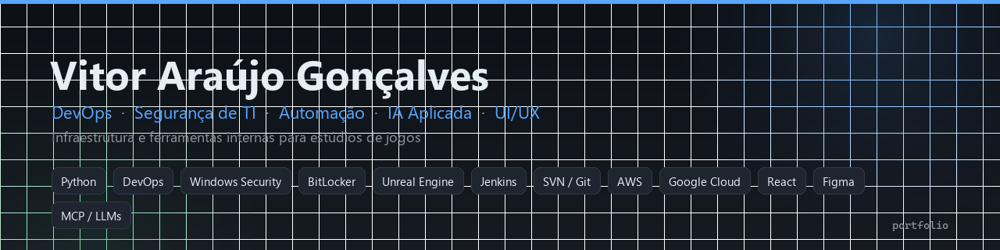
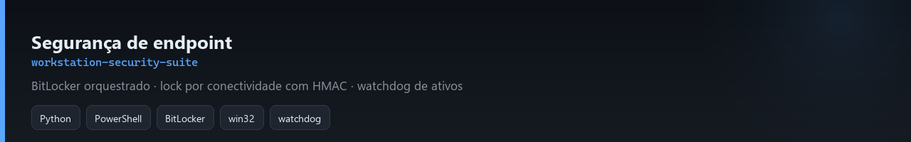
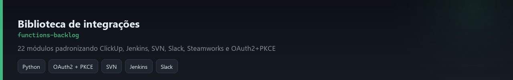
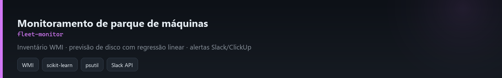
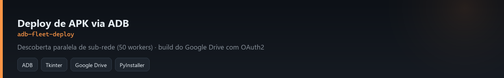
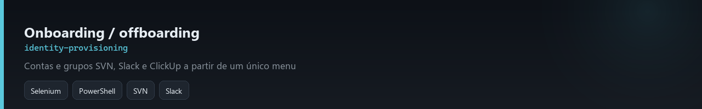
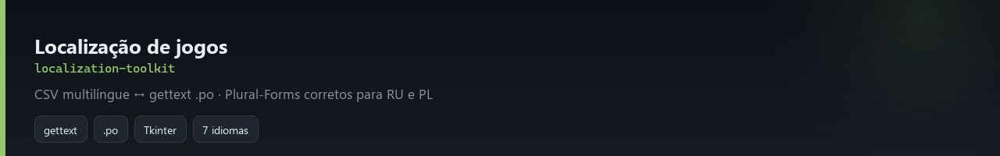

# 👋 Olá, sou Vitor Araújo Gonçalves

**DevOps · Segurança de TI · Analista de TI · IA Aplicada · UI/UX**

---

## Estatísticas do portfólio

Trabalho como devops, principalmente usando Python. Nos últimos anos fui o responsável por manter estações de trabalho, builds, servidores e versionamento de estúdios funcionando — e, quando faltava ferramenta, eu construía.

Este perfil reúne as **ferramentas internas que escrevi**, sanitizadas para publicação: sem credenciais, hosts internos, nomes de projeto ou dados de terceiros.

---

## 🛠️ Stack

| Área | O que faço |
|---|---|
| **Segurança de endpoint** | BitLocker orquestrado, automação de gestão de usuários Windows, hardening por registro/GPO, detecção de exfiltração de ativos |
| **DevOps & Infra** | Python, CI/CD e controle de builds, Jenkins, SVN/Git, administração de servidores, AWS, Google Cloud |
| **Game Dev Ops** | Pipelines de build Unreal Engine 5, Steamworks, servidores dedicados, localização (gettext/.po) |
| **IA aplicada ao dev** | Plugins MCP (Model Context Protocol), integração de LLMs em pipeline, agentes de código, inferência local (llama.cpp) |
| **Monitoramento** | WMI, psutil, alertas Slack/ClickUp, previsão de capacidade com regressão linear |
| **UI/UX & Web** | Figma, Adobe Illustrator/Photoshop, React, Tkinter |

---

## 📌 Repositórios

### 🛡️ [workstation-security-suite](https://github.com/Jimhow-01/workstation-security-suite)

Estação que se auto-endurece: BitLocker orquestrado, lock por queda de conectividade com desbloqueio HMAC-SHA256, watchdog de ativos contra cópia de conteúdo de projeto.

### 🧰 [functions-backlog](https://github.com/Jimhow-01/functions-backlog)

Biblioteca de 22 módulos / ~7 mil linhas padronizando ClickUp, Jenkins, SVN, Slack, Steamworks, Maya e OAuth2+PKCE.

### 📊 [fleet-monitor](https://github.com/Jimhow-01/fleet-monitor)

Inventário de hardware por WMI + previsão de esgotamento de disco com regressão linear, alertando antes de virar incidente.

### 🚀 [adb-fleet-deploy](https://github.com/Jimhow-01/adb-fleet-deploy)

Deploy de APK via ADB com descoberta paralela de sub-rede (50 workers) e build vindo do Google Drive com OAuth2.

### 🪪 [identity-provisioning](https://github.com/Jimhow-01/identity-provisioning)

Onboarding/offboarding de identidade em SVN, Slack e ClickUp a partir de um único menu.

### 🌍 [localization-toolkit](https://github.com/Jimhow-01/localization-toolkit)

CSV multilíngue ↔ arquivos `.po` por idioma, com `Plural-Forms` corretos para russo e polonês.

---

## ⚠️ Sobre o que está aqui — e sobre titularidade

São **scripts internos de TI**, não produtos. Foram sanitizados para publicação: tokens, senhas, IPs, hosts internos, nomes de projeto e dados de terceiros viraram variáveis de ambiente ou placeholders. O estúdio onde trabalhei não é nomeado de propósito.

**Não estou reivindicando direitos sobre este código.** Parte dele foi produzida como funcionário, e direitos sobre trabalho de empregador pertencem ao empregador. Publico como demonstração de como resolvi os problemas — para leitura e estudo, não como software livre (sem licença concedida, ver `LICENSE` de cada repositório).

Alguns repositórios têm dívida técnica e limitações de segurança que declaro explicitamente no README — TLS com `CERT_NONE`, credencial na linha de comando, XPath frágil, um EventID usado como proxy errado. Prefiro mostrar o código real com as limitações escritas a esconder tudo.

---

## 📬 Contato

Aberto a vagas de **DevOps / Infraestrutura / TI em estúdios de jogos**.

Porto Alegre, RS · disponível para trabalho remoto
